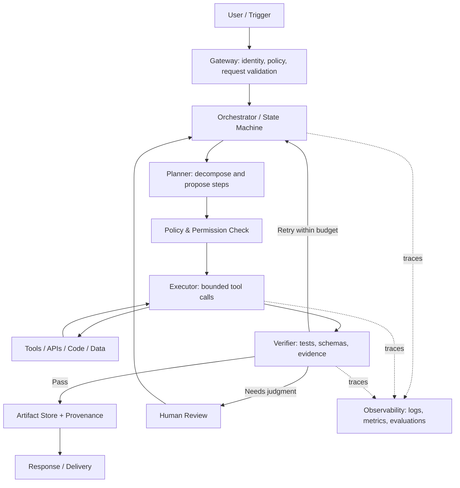

# Reusable AI Agent Architectures

A practical architecture library for designing reliable, reusable AI agents. These are reference patterns, not claims that one framework is universally best. Select the simplest architecture that meets the task's reliability, latency, privacy, cost and safety requirements. Follow the [sequential architecture learning path](learning-path.md) for a guided progression from deterministic workflows to production hardening.

## Design principles

1. **Workflow before autonomy:** prefer deterministic steps for known processes; introduce agent decisions only where uncertainty requires them.
2. **Small, typed tools:** expose narrow capabilities with explicit input/output schemas, validation, timeouts and permission boundaries.
3. **Explicit state:** keep task state, artifacts, decisions and provenance outside the model context.
4. **Bounded execution:** cap steps, retries, tool calls, time, tokens and spend.
5. **Verify consequential outputs:** use tests, validators, independent checks or human approval.
6. **Least privilege:** grant each agent only the tools and data needed for its role.
7. **Observability by design:** record traces, tool arguments/results (with secrets redacted), latency, token usage and errors.
8. **Reproducibility:** version prompts, tools, models, datasets and evaluation suites.
9. **Graceful failure:** classify failures, preserve partial work and provide a clear recovery path.
10. **Human control:** require approval for irreversible, external, financial, security-sensitive or production actions.

## Reference architecture



### Core components

- **Gateway:** authentication, rate limits, request normalization, data classification.
- **Orchestrator:** owns the workflow state machine, deadlines, budgets and cancellation.
- **Planner:** creates a structured plan; plans are proposals, not permissions.
- **Policy engine:** authorizes each tool call against user, task and resource permissions.
- **Executor:** validates arguments, invokes tools, handles timeouts and retries.
- **Memory/context service:** retrieves only task-relevant, permission-checked information.
- **Artifact store:** stores files, code, reports and intermediate results with version/provenance.
- **Verifier:** checks output against explicit acceptance criteria.
- **Human review:** approval gates for high-impact actions and ambiguous decisions.
- **Observability/evaluation:** traces, audit events, quality, safety, cost and latency.

## Architecture patterns

| Pattern | Use when | Main risk |
|---|---|---|
| Single agent + tools | One task with limited branching | Overloaded agent prompt |
| Deterministic workflow + LLM steps | Process is known, language tasks are variable | Rigid error paths |
| Router + specialist agents | Requests split into distinct domains | Incorrect routing |
| Planner–executor–verifier | Multi-step tasks need validation | Planner/executor drift |
| Supervisor + workers | Parallel independent subtasks | Coordination overhead |
| Event-driven agents | Work is triggered by external events | Duplicate/out-of-order events |
| Human-in-the-loop | High-impact or ambiguous decisions | Approval bottlenecks |
| Retrieval-grounded agent | Decisions need large/private knowledge bases | Retrieval misses or stale sources |

### Additional pattern: probability-aware routing

[Probabilistic Routing with an Abstain Path](patterns/probabilistic-routing-abstain.md) — use calibrated estimates to route ambiguous work safely, with explicit abstention and independent authorization.

## Reusable agent roles

- **Intake/router:** classify intent, extract constraints, route to a workflow.
- **Researcher:** gather evidence and attach source provenance; cannot approve its own unsupported claims.
- **Architect:** turn requirements into components, interfaces, data flows, trade-offs and acceptance criteria.
- **Planner:** decompose approved work into bounded steps and dependencies.
- **Builder/executor:** implement only approved tasks using authorized tools.
- **Reviewer:** inspect artifacts against requirements; should be independent of the builder when possible.
- **Test/evaluation agent:** run defined tests and report reproducible results.
- **Security/policy agent:** inspect permissions, secrets, data handling and unsafe actions.
- **Release agent:** prepare release artifacts; deployment requires explicit authorization.

Do not create a separate agent for every role by default. Roles may be modules in one orchestrator until isolation, parallelism or independent verification justifies separate agents.

## Suggested repository layout

```text
agent-architectures/
  README.md
  reference-architecture.md
  patterns/
  templates/
  examples/
  evals/
```

## Quality gate before reuse

A design is not production-ready until it defines: threat model, permissions, tool schemas, state persistence, retry/idempotency policy, budgets, timeout/cancellation, evaluation dataset, acceptance thresholds, monitoring, incident recovery and human approval boundaries.

## Further reading

- [OWASP Top 10 for LLM Applications](https://owasp.org/www-project-top-10-for-large-language-model-applications/)
- [NIST AI Risk Management Framework](https://www.nist.gov/itl/ai-risk-management-framework)
- [Model Context Protocol documentation](https://modelcontextprotocol.io/docs)
- [Google SRE Workbook](https://sre.google/workbook/table-of-contents/)
