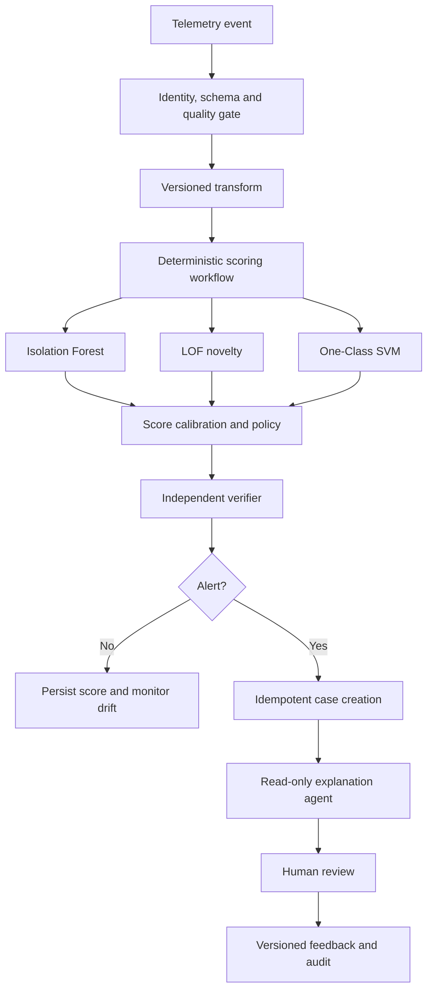

# A20 — Anomaly Detection and Human Triage Gate

## Purpose

Use unsupervised/novelty detectors to surface unusual telemetry while preventing a statistical score or an LLM explanation from being treated as a confirmed hardware fault or an authorization to act.

## When to use

- Fault labels are sparse, delayed or incomplete.
- New failure modes may differ from previously labelled incidents.
- Telemetry is available as bounded windows with a stable feature contract.
- Engineers need ranked, traceable investigation candidates.

Do not use this pattern as the sole safety mechanism for protection-critical limits. Keep deterministic hardware limits and safety interlocks independent.

## Architecture



## Component contracts

### 1. Intake/router agent

Input: a natural-language request to explore or score a device/window.  
Output: a typed request containing authorized scope, window ID, feature schema version, requested detector family and experiment budget.

The router may recommend Isolation Forest, LOF or One-Class SVM based on documented workload characteristics. It must not grant data permissions, modify thresholds or issue hardware actions.

### 2. Data contract and transform service

Validate:

- tenant/device authorization;
- feature names, order, units and dtypes;
- missingness, NaN/Inf, range and freshness;
- operating mode and workload context;
- transform/scaler version and feature hash.

Never fit a new scaler or PCA transform during online scoring. The model artifact and preprocessing artifact are one versioned bundle.

### 3. Detector workers

Each worker returns a typed record:

```json
{
  "detector": "lof_novelty",
  "detector_version": "sha256:...",
  "feature_schema_version": "telemetry-v3",
  "score": -0.18,
  "score_direction": "negative_is_more_anomalous",
  "threshold": 0.0,
  "decision": "outlier",
  "duration_ms": 3.7
}
```

The score is illustrative. Raw scores from different algorithms are not directly comparable. If combining detectors, use a calibrated validation procedure, ranks, or an explicit voting policy; record its version.

### 4. Deterministic policy gate and verifier

Check finite scores, schema/model compatibility, freshness, alert rate limits, duplicate keys and threshold-policy version. The verifier should recompute critical invariants independently of the explanation model.

An `insufficient_data` or `stale_model` result is not a normal result. Route it to a safe fallback or human queue.

### 5. Case store and human review

Use case states such as `new`, `reviewing`, `confirmed`, `dismissed`, `escalated`. Store evidence references, reviewer identity, decision reason and timestamp. Only approved feedback can enter the labelled incident corpus; retain provenance and expiry.

## Agent pattern selection

| Pattern | Application | Guardrail |
|---|---|---|
| Deterministic workflow | Validate → transform → score → policy → case | Default online path; no model-selected control flow for safety-critical steps |
| Single agent + typed tools | Read-only experiment assistant | Allow-listed tools, schema validation, bounded calls |
| Router-specialist | Choose detector/analysis specialist | Routing is not authorization; retain fallback |
| Planner–executor–verifier | Bounded offline parameter sweeps | Immutable dataset fingerprint and independent metric verification |
| Supervisor–worker | Parallel independent candidate experiments | Resource quotas and deterministic aggregation |
| Event-driven | Asynchronous telemetry ingestion | Event ID, idempotency key, checkpoints, dead-letter queue |
| Human-in-the-loop | Confirm findings and approve threshold/model changes | Authenticated reviewer and immutable audit trail |

## State and memory

Persist the minimum durable state needed to reproduce a decision:

- event ID, device scope and telemetry window;
- feature schema, unit map and transform/scaler version;
- model bundle and threshold-policy versions;
- scores, data-quality status and timestamps;
- case state, retries, checkpoint and trace ID;
- reviewer decision and provenance.

Do not treat raw conversation history as operational truth. Approved incident annotations can be retrieved as episodic knowledge only with access control, provenance and expiry.

## Security boundaries

- Treat uploaded logs, traces, firmware strings and device names as untrusted content.
- Keep LLM explanation tools read-only.
- Enforce tenant/device access in the service layer.
- Never expose unrestricted SSH, shell, register-write, reset or firmware-flash tools to the agent.
- Redact secrets and sensitive identifiers from prompts and traces.
- Validate payload sizes, file types, schema versions and timestamps.
- Require separate human approval and authorization for any corrective action.

## Evaluation contract

Evaluate on time-ordered and device/group-aware holdouts where possible. Avoid windows from the same incident or device session crossing train and test boundaries.

Required metrics:

- precision, recall, F1, PR-AUC and ROC-AUC;
- recall at a fixed FPR and precision@K;
- alerts per device-day and analyst acceptance;
- time-to-detect and time-to-triage;
- score/feature drift and stability by operating mode;
- missing/stale data rate and detector disagreement.

Evaluate at realistic base rates. A good ROC-AUC does not guarantee a manageable alert queue.

## Observability

Emit structured spans/events with:

- `request_id`, `event_id`, `case_id`, `trace_id`;
- authorized device scope (opaque or redacted);
- feature schema and transform versions;
- detector/model and threshold-policy versions;
- score direction, decision and duration;
- retry count, queue age and final outcome.

Track p50/p95/p99 latency, throughput, CPU, memory, cost per million windows, alert volume and dead-letter count. Avoid logging raw telemetry unless explicitly approved.

## Reliability and cost/latency

- Use bounded retries for transient queue/storage failures only.
- Use an idempotency key such as `(device_id, window_start, feature_schema_version, model_bundle_version)`.
- Checkpoint offline experiments and store artifacts by immutable hash.
- Bound worker concurrency, memory and compute budget.
- Keep LLM summarization asynchronous/optional; model scoring must continue during an LLM outage.
- Use a last-known-good model only when freshness and schema compatibility pass.
- If input is missing, stale or incompatible, return `insufficient_data`, not `normal`.

## Failure modes and tests

| Failure | Expected behavior | Test |
|---|---|---|
| Missing required feature | Reject/insufficient data | Schema contract test |
| NaN/Inf or impossible units | Quarantine input | Data-quality test |
| Stale model bundle | Block score or route to approved fallback | Freshness test |
| Duplicate event | Return existing case/result | Idempotency test |
| Detector timeout | Bounded retry, then partial/unavailable status | Timeout test |
| LOF called in wrong mode | Fail validation | API contract test |
| Detector scores disagree | Preserve individual scores and request review | Disagreement test |
| Prompt injection in log text | Treat as data, do not change tool policy | Adversarial content test |
| LLM unavailable | Continue deterministic scoring; omit summary | Dependency outage test |
| Unapproved remediation request | Deny and audit | Authorization test |

## Cost and latency decisions

- Isolation Forest is a useful scalable baseline for sparse anomalies.
- LOF can be more expensive because of neighbor search; use it where local-density context is valuable.
- RBF One-Class SVM needs careful scaling and can become expensive as sample count grows.
- Parallel scoring reduces wall-clock time only if CPU/memory contention is controlled.
- A cascade (cheap score then expensive specialist) must be validated for missed anomalies, not selected solely on average latency.
- Measure cost per reviewed useful alert, not only inference cost per sample.

## Acceptance criteria

A production implementation is not ready until:

1. The reference population and data split are documented.
2. Preprocessing and detector artifacts are versioned together.
3. Thresholds are validated at realistic base rates and alert budgets.
4. Duplicate events and transient failures are tested.
5. Missing/stale data cannot be silently labelled normal.
6. The explanation agent is read-only and prompt-injection tested.
7. Human decisions are authenticated and auditable.
8. Quality, drift, latency, resource use and cost dashboards exist.
