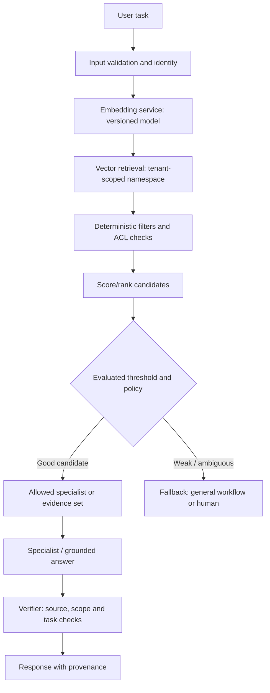

# Embedding Retrieval and Specialist Routing Pattern

A reusable reference pattern for using vector representations to retrieve knowledge or suggest a domain specialist. Similarity ranks candidates; it does not establish truth, authorization or calibrated confidence.

## Architecture



## Component boundaries

- **Embedding service:** owns preprocessing and a pinned embedding model/version. Query and indexed document vectors must be compatible.
- **Vector index:** stores vectors with source IDs, namespace/tenant, document version and access metadata.
- **Retrieval service:** accepts a typed query, applies tenant isolation and returns candidate IDs, similarity scores and metadata.
- **Policy layer:** performs authorization outside the model. A high similarity score never grants access.
- **Router:** maps candidates to a fixed allow-list of specialist IDs; unknown destinations fall back safely.
- **Verifier:** checks evidence provenance, freshness, permissions and whether the selected specialist actually addresses the task.

## Example tool contracts

Input (conceptual schema):

```json
{
  "query_vector": "float32[d]",
  "embedding_model": "embedding-model-v3",
  "namespace": "tenant/project",
  "top_k": 5,
  "filters": {"document_status": "approved"}
}
```

Output:

```json
{
  "index_version": "index-2026-11",
  "candidates": [
    {"source_id": "doc-123#chunk-4", "score": 0.82, "specialist_id": "audio-dma"}
  ]
}
```

These are illustrative contracts. A real implementation must define JSON Schema, validate vector dimension and finite values, constrain top-k, authorize namespace access and avoid trusting model-generated tenant identifiers.

## Design trade-offs

| Decision | Benefit | Risk / control |
|---|---|---|
| Embedding router | Handles varied natural-language requests | Similarity may be misleading; evaluate thresholds and fallback |
| One general agent | Simple orchestration and fewer handoffs | May need a large prompt and broad tool permissions |
| Specialist agents | Narrow context and scoped tools | Routing errors and orchestration overhead |
| Larger top-k | Better chance of retrieving relevant candidates | More latency, context and noise |
| More aggressive filtering | Less irrelevant content | May exclude useful evidence; test recall |
| Cached embeddings | Lower latency and cost | Invalidate on model/preprocessing version changes |

## Production requirements

1. Pin embedding model, tokenizer/preprocessor and index versions.
2. Reject wrong dimensions, NaN/Inf values and excessive vector lengths.
3. Enforce namespace and document ACLs before returning content.
4. Treat retrieved documents as untrusted data; defend against prompt injection.
5. Use a deterministic allow-list for specialist routing.
6. Calibrate thresholds on representative labelled requests; do not interpret raw similarity as probability.
7. Measure retrieval recall@k, precision@k, routing accuracy, fallback rate, end-to-end task success, latency and cost.
8. Trace query ID, model/index versions, dimensions, top-k, candidate IDs, score distribution and policy decisions; redact sensitive text.
9. Provide a no-match path and human escalation for ambiguous/high-impact tasks.
10. Compare the router with a simple keyword or deterministic baseline before adding more agents.

## Evaluation set

Build a versioned dataset with:
- Clear single-domain requests
- Multi-domain requests
- Ambiguous and underspecified requests
- Out-of-domain requests
- Adversarial requests attempting to select unauthorized specialists
- Requests with stale or restricted documents

Measure routing accuracy and false routing separately. A safe fallback is often preferable to a confident but incorrect specialist selection.
