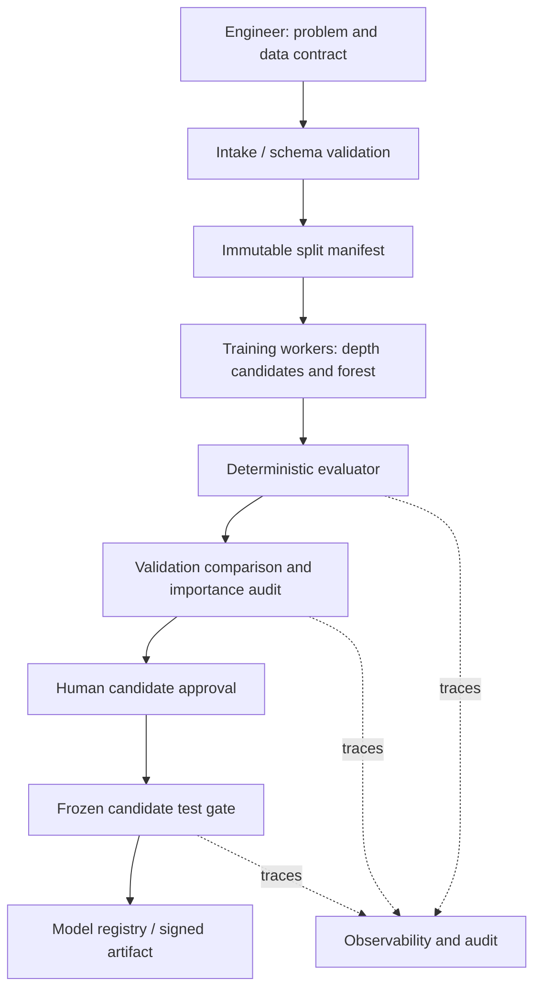

# A16 — Tree Ensemble Experiment Gate

## Purpose

Provide a repeatable, auditable workflow for comparing decision trees and random forests without allowing an LLM or experiment worker to bypass dataset boundaries, evaluation contracts or deployment approval.

This is an orchestration and governance pattern around deterministic ML tooling. It is not an autonomous hardware-control agent.

## Architecture



## Component contracts

| Component | Owns | Must not do |
|---|---|---|
| Intake/router | Validate target, features, dataset version, task and risk | Invent labels or silently drop rows |
| Split service | Create immutable random/stratified/group/time manifests | Re-split during candidate comparison |
| Training worker | Fit one allow-listed configuration on train data | Read final test labels or modify split policy |
| Evaluator | Compute versioned metrics from predictions and labels | Choose metrics after seeing test results |
| Importance auditor | Run permutation tests on validation data | Claim causal feature effects |
| Human approver | Review model card, risk and evidence | Approve without provenance |
| Test gate/registry | Test one frozen candidate and register approved artifact | Tune thresholds or features against test labels |

## Typed tool contracts

Example training request:

```json
{
  "tool": "train_tree_candidate",
  "input": {
    "dataset_version": "telemetry-v3",
    "split_manifest_id": "split-2026-11-28-a",
    "model_type": "decision_tree",
    "max_depth": 6,
    "min_samples_leaf": 3,
    "random_seed": 7
  }
}
```

Example response:

```json
{
  "run_id": "run-1042",
  "artifact_uri": "registry-staging/model-1042",
  "metrics_ref": "metrics-1042",
  "status": "completed"
}
```

Validate the schema and parameter ranges at the tool boundary. A model-generated plan is a proposal, never an authorization.

## State and event model

Persist:
- experiment ID and owner
- dataset version, schema hash and split-manifest ID
- train/validation/test row-group references under controlled access
- model configuration, seed and library versions
- run state, retries, timestamps and worker identity
- artifact checksum and immutable metrics reference
- approval decision, approver and reason
- test-gate result and registry version

For asynchronous candidate runs, use durable events with idempotency keys. Bound concurrent jobs, CPU/GPU/memory use, retries, wall-clock time and total cost. Send exhausted jobs to a dead-letter queue. Checkpoint long jobs where supported.

## Evaluation and feature-importance policy

- Define the primary metric and guardrails before fitting.
- Compare candidates on the same validation split.
- Include a simple baseline.
- Track class prevalence and confusion matrix.
- Treat MDI as a model-internal split statistic, not causal evidence.
- Calculate permutation importance on validation data, with repeated shuffles and uncertainty.
- For correlated features, consider grouped permutation and domain-informed ablation.
- Freeze model, preprocessing, threshold and configuration before opening the test gate.
- Never use test results to choose another model and report that same test score as an unbiased final estimate.

## Security

- Enforce dataset and test-label permissions in service code.
- Treat dataset text, logs and retrieved files as untrusted data.
- Sandbox training and restrict filesystem/network access.
- Redact sensitive rows and secrets from traces.
- Verify model artifact provenance and dependency versions.
- Require human approval before promotion or hardware-control integration.

## Reliability, observability and cost

Trace experiment ID, split ID, candidate ID, model version, worker, start/end time, retries, resource usage, metric reference and approval state. Avoid logging raw sensitive examples.

Measure:
- candidate completion and failure rates
- reproducibility across reruns
- train and inference latency
- peak memory and artifact size
- cost per completed candidate and per accepted model
- validation-to-test generalization gap
- stability of feature importance across seeds/splits

## Architecture selection

Use a deterministic workflow for the fixed training/evaluation pipeline. A single assistant with typed tools is enough for an individual engineer's experiment. Use supervisor/worker orchestration only when candidates are independent and measured parallelism helps. Use event-driven jobs for long training runs. Put human approval before deployment. Do not use extra agents where a simple function or state machine is more reliable.

## Acceptance tests

1. Invalid schema or unknown feature is rejected.
2. Worker cannot read test labels during tuning.
3. Duplicate event does not create a second side effect.
4. Retry does not exceed budget or duplicate registration.
5. Metrics are reproducible for a pinned seed/runtime.
6. Candidate is frozen before test evaluation.
7. Test failure prevents promotion.
8. Approval identity and artifact checksum are retained.
9. Prompt injection in data/log text cannot change tool permissions.
10. Traces contain no raw secret or unauthorized data.
