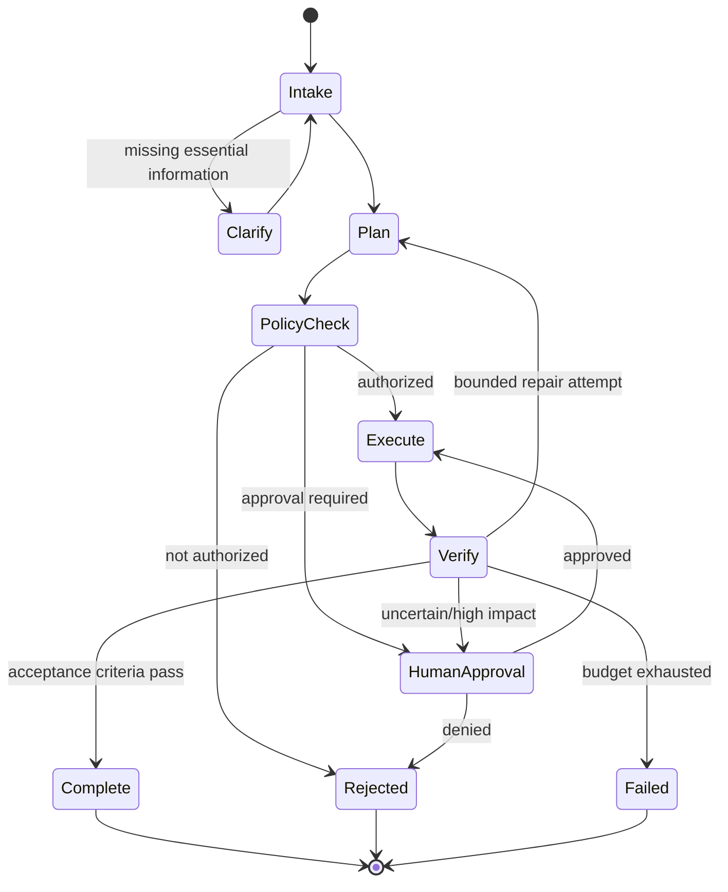

# Production-Ready Agent Blueprint

## 1. Request contract

Every run starts with a normalized task object:

```json
{
  "task_id": "stable-unique-id",
  "goal": "What outcome is requested?",
  "constraints": ["time", "cost", "privacy", "format"],
  "inputs": [],
  "acceptance_criteria": [],
  "risk_level": "low|medium|high",
  "requested_actions": [],
  "deadline": null
}
```

Validate required fields before invoking a model. Treat user-provided documents, web pages, tool output and retrieved content as untrusted data, never as policy instructions.

## 2. State machine



Persist state transitions and artifact references so a run can resume safely after interruption.

## 3. Tool contract

Each tool should declare:
- Stable name and version
- Purpose and allowed caller roles
- JSON input schema and output schema
- Required scopes/permissions
- Side-effect classification (read-only, reversible write, irreversible write)
- Timeout, retry policy and idempotency key behavior
- Data classification and redaction rules
- Failure codes and recovery guidance

Never let a model invent tool names, bypass schema validation or expand its own permissions.

## 4. Memory model

Separate memory by purpose:
- **Working state:** current task, plan, step status and temporary observations.
- **Episodic record:** prior task outcomes with provenance and retention policy.
- **Knowledge base:** curated, versioned reference documents.
- **User preferences:** only relevant, consented preferences with controls.

Retrieve minimum necessary context. Attach source IDs, timestamps and confidence to factual claims. Provide deletion/retention controls appropriate to the application.

## 5. Reliability controls

- Set maximum plan steps, tool calls, wall-clock time and token/cost budgets.
- Retry only transient failures; use exponential backoff with jitter in the runtime.
- Require idempotency keys for operations that may be retried.
- Detect loops and repeated identical tool calls.
- Use circuit breakers for failing dependencies.
- Support cancellation and checkpointing.
- Keep a dead-letter/recovery path for failed asynchronous jobs.

## 6. Verification and evaluation

Define acceptance criteria before execution. Evaluate:
- Task success and completeness
- Factuality and citation/provenance correctness
- Tool selection and argument validity
- Security/policy violations
- Robustness to malformed and adversarial inputs
- Latency, tokens, cost and retry rate
- Human escalation rate

Use deterministic tests for code and schemas; use model-based grading only as one signal, not the sole release gate. Maintain regression cases and evaluate every prompt, model or tool change.

## 7. Security boundaries

- Treat prompt injection as an input threat.
- Separate instructions from retrieved/user content.
- Enforce authorization in code, not in prompt text alone.
- Keep secrets in a secret manager; never place them in prompts or logs.
- Sandbox code execution and restrict network/filesystem access.
- Require explicit confirmation before irreversible or external actions.
- Log audit events without retaining unnecessary sensitive content.

## 8. Deployment topology

Start with a single service and a durable state store. Split components only when scale, isolation, latency or team ownership requires it.

Typical production components: API gateway, orchestrator, model gateway, tool services, retrieval service, durable queue, artifact/object store, relational state store, telemetry pipeline and evaluation service.

## 9. Release checklist

- [ ] Requirements and threat model documented
- [ ] Tool schemas and permissions reviewed
- [ ] Budgets, timeout, retries and cancellation configured
- [ ] State persistence and recovery tested
- [ ] Prompt injection and data leakage tests passed
- [ ] Evaluation and regression suite meets thresholds
- [ ] Traces, metrics, alerts and audit records available
- [ ] Human approval gates tested
- [ ] Rollback and incident procedures documented
