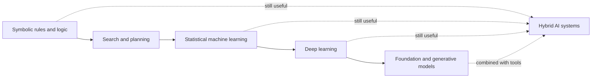
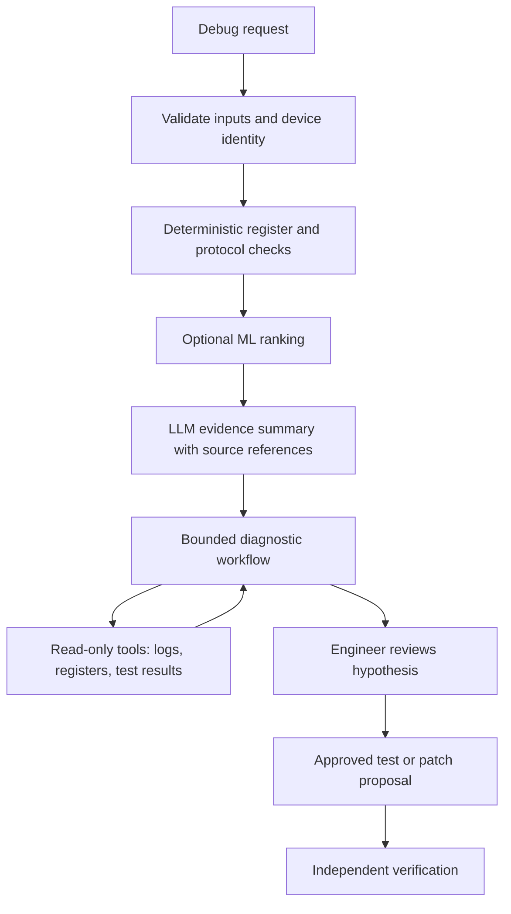

# Day 002 — How AI Systems Evolved: Rules, Search, Learning and Generative Models

**Duration:** 60 minutes  
**Level:** Beginner → early intermediate  
**Phase:** 1 — AI foundations  
**Previous lesson:** [Day 001 — What Is Artificial Intelligence?](../day-001/README.md)

## Learning objectives

By the end of this session, you should be able to:

1. Explain why different AI paradigms emerged and which limitations they address.
2. Distinguish rule-based systems, search/planning, statistical machine learning, deep learning and generative models.
3. Frame an AI problem before selecting an algorithm or model.
4. Choose a sensible first implementation using data availability, uncertainty, risk, latency and cost.
5. Explain why reliable AI products often combine deterministic software with models rather than making everything an autonomous agent.

## 60-minute lesson plan

| Time | Activity |
|---|---|
| 0–5 min | Recall Day 001 and introduce the design question |
| 5–17 min | Historical backstory: why each paradigm emerged |
| 17–30 min | Compare the paradigms and their trade-offs |
| 30–40 min | Problem formulation: input, output, evidence and cost of error |
| 40–52 min | Hands-on Python lab: build and test a rule-based diagnostic baseline |
| 52–57 min | Architecture selection: workflow, model or agent? |
| 57–60 min | Five-question review and next lesson |

## 1. The central design question

A common beginner mistake is to start by asking, "Which AI model should I use?"

Start one level earlier:

> What decision or output must the system produce, from which evidence, under what constraints, and how will we know whether it is correct?

AI is a family of approaches. A small, explicit rule may be better than a large neural network. A search algorithm may be better than a language model when the state space and legal moves are well-defined. A learned model is useful when patterns are too numerous or subtle to encode manually and representative data exists.

The paradigms below did not simply replace one another. They coexist because they solve different kinds of problems.

## 2. The backstory: why the paradigms emerged

### 2.1 Symbolic AI and rule-based expert systems

Early AI research explored whether reasoning could be represented using symbols, logic, search and explicit knowledge. Instead of learning every behavior from examples, engineers encoded facts and rules.

A simplified expert system looks like this:

```text
Facts + Knowledge Base + Inference Engine → Conclusion
```

Example:

```text
IF link_is_down AND receiver_detects_no_signal
THEN investigate physical link or power/reset
```

**Why it was attractive**
- Domain experts could inspect and review the rules.
- Rules could encode explicit policy or engineering knowledge.
- A system could work with little or no training dataset.
- The inference path could be deterministic and auditable.

**Why it became difficult**
- Experts had to translate knowledge into rules manually.
- Exceptions and interacting rules accumulated.
- New conditions could invalidate old assumptions.
- A rule engine could not automatically discover a useful pattern that nobody had encoded.

This is often called the *knowledge acquisition bottleneck*. Rule systems remain valuable for stable policies, protocol constraints, safety interlocks and known failure signatures.

### 2.2 Search and planning

Some problems are not primarily about recognizing a pattern. They are about finding a sequence of valid actions.

A search system explores a state space:

```text
Initial State → Candidate Actions → New States → Goal Test
                         ↑                         |
                         └──── continue search ────┘
```

Examples include route finding, puzzle solving, scheduling and planning a sequence of operations. Algorithms such as breadth-first search, depth-first search and A* differ in how they explore states and trade off completeness, memory and path cost.

**Why it emerged:** explicit rules alone do not tell us which sequence of actions reaches a goal. Search provides a systematic way to explore alternatives.

**Limitation:** the state space can grow very quickly. Search also needs a well-defined state representation, legal actions and goal condition. A language model may help propose actions, but a trusted planner or validator should enforce legal transitions.

### 2.3 Statistical machine learning

As datasets and computing resources became more available, a different strategy became practical: specify examples and the desired outcomes, then fit a model to patterns in those examples.

For supervised learning, each labelled example contains:
- **Features** — input values used to make a prediction.
- **Label** — the target answer the model should learn to predict.

The model learns a relationship from labelled examples and is evaluated on data it did not train on. Dataset diversity matters: a large dataset that omits important operating conditions can still generalize poorly. See Google's explanation of [supervised learning](https://developers.google.com/machine-learning/intro-to-ml/supervised).

**Why it was attractive**
- It reduced the need to hand-write every decision boundary.
- It could discover statistical relationships in large datasets.
- It could be evaluated quantitatively on held-out examples.

**Limitations**
- It needs representative data and a meaningful target label.
- Correlations are not automatically causal explanations.
- Distribution changes can degrade performance.
- Label noise, imbalance and leakage can create misleading results.

### 2.4 Deep learning

Deep learning uses multi-layer neural networks to learn useful representations from data. It became especially effective for high-dimensional inputs such as images, speech and text, where manually designing every feature is difficult.

**Why it mattered:** instead of relying entirely on hand-crafted features, the model can learn intermediate representations during training.

**Trade-offs:** training can require substantial data and compute; model behavior may be harder to interpret; inference latency, memory and energy become deployment constraints.

### 2.5 Foundation models and generative AI

Large pre-trained models learn broad statistical structure from large collections of data, then can be adapted or prompted for many downstream tasks. Generative models produce new outputs such as text, code, images or audio.

**Why they are useful**
- They can handle flexible language and mixed-context tasks.
- One model can support many tasks without training a separate model from scratch for each.
- They can interpret unstructured information and generate candidate explanations or plans.

**Why they need engineering controls**
- Outputs are probabilistic and can be incorrect.
- They may invent details or follow malicious instructions embedded in untrusted content.
- Long context and repeated tool calls can increase cost and latency.
- A fluent explanation is not proof that a conclusion is correct.

### A useful mental timeline



This is a simplified history of major approaches, not a strict sequence in which one era made the previous one obsolete. Research on AI's "waves" also emphasizes that modern neural systems retain robustness and trustworthiness challenges; see Jenkins, Lopresti and Mitchell, [Next Wave Artificial Intelligence](https://arxiv.org/abs/2012.06058).

## 3. Compare the approaches

| Approach | Best fit | Main requirement | Common failure |
|---|---|---|---|
| Rules / expert system | Stable, explicit conditions and policy | Domain knowledge | Brittle rule growth |
| Search / planning | Known states, legal actions and goal | State/action model | State-space explosion |
| Supervised ML | Repeated prediction with labelled examples | Representative labelled data | Poor generalization |
| Unsupervised ML | Discovering structure without target labels | Representative unlabelled data | Groups may not be meaningful |
| Deep learning | Complex high-dimensional patterns | Data, compute and evaluation | Cost, opacity, distribution shift |
| Generative model | Flexible language/content transformation | Suitable model and grounding | Hallucination, prompt injection |
| Agentic system | Multi-step task with dynamic tool choices | Bounded tools, state and verification | Uncontrolled actions and loops |

A hybrid design is common. Use rules for hard constraints, a model for uncertain predictions, retrieval for authoritative facts, and an agent only where the next step genuinely depends on intermediate results.

## 4. Frame the problem before choosing a model

Write a one-page problem statement using these questions:

1. **Goal:** what real-world decision or output is needed?
2. **Unit of prediction/action:** one event, one device, one document, one user request or one time window?
3. **Inputs:** which fields, signals, logs or documents are available at decision time?
4. **Output:** class, number, ranking, generated text, recommended action or sequence?
5. **Ground truth:** who or what determines the correct answer?
6. **Feedback:** can outcomes be observed later and used to improve the system?
7. **Error costs:** what happens for a false positive versus a false negative?
8. **Constraints:** latency, throughput, memory, compute, privacy, auditability and budget?
9. **Fallback:** what should happen when evidence is missing or confidence is low?
10. **Acceptance test:** what measurable result would justify deployment?

### Worked example: investigating an intermittent SoC DMA timeout

Suppose a debug system receives:
- DMA timeout count
- Retry count
- Bus error count
- Reset observed
- Link or interconnect status
- Relevant logs and register snapshots

Do not immediately ask an LLM to "find the bug." First separate what each technique can responsibly do.

| Component | Responsibility | Why |
|---|---|---|
| Deterministic checks | Validate register fields, reset state and known error bits | Exact specifications should be enforced exactly |
| Statistical model (later) | Rank likely failure classes from historical labelled runs | Patterns may be too complex for a few rules |
| LLM | Summarize logs and explain candidate evidence | Language is useful for unstructured information |
| Retrieval | Fetch the relevant specification and known issue notes | Ground claims in authoritative material |
| Agent workflow | Decide which permitted read-only diagnostic query to run next | The next step may depend on previous findings |
| Human engineer | Approve source changes, firmware changes or risky actions | Consequential actions require ownership and review |

A safe architecture is:



The LLM should not invent register values, and the agent should not write registers, flash firmware or merge RTL patches without an explicit authorization boundary.

## 5. When should a workflow become an agent?

An agent is not automatically better than a workflow. Use the least complex architecture that meets the requirement.

| Situation | Preferred starting point |
|---|---|
| Same steps every time | Deterministic workflow |
| One model call with a few safe tools | Single agent + typed tools |
| Several clearly separated domains | Router → specialist |
| Multi-step task with evidence and checks | Planner → executor → verifier |
| Independent subtasks can run in parallel | Supervisor → workers |
| Work starts from events or telemetry | Event-driven workflow |
| Action is high impact or ambiguous | Human-in-the-loop |

For reusable reference designs, see [agent-architectures/README.md](../../agent-architectures/README.md) and the [architecture learning path](../../agent-architectures/learning-path.md).

### Production design principles preview

- **Component boundaries:** separate orchestration, model calls, policy checks, tool execution, retrieval, state storage and verification.
- **State and memory:** persist task state and artifact references outside the model context; do not treat chat history as a database.
- **Typed tools:** define input/output schemas, permissions, timeouts and side-effect levels.
- **Security:** treat retrieved documents and tool outputs as untrusted; enforce authorization in code, not only in prompts.
- **Evaluation:** use a versioned set of representative cases and measurable acceptance criteria.
- **Observability:** trace model calls, tool calls, latency, token use, errors and verification outcomes; redact secrets.
- **Reliability:** use bounded retries, idempotency for writes, cancellation, checkpoints and recovery paths.
- **Cost/latency:** measure end-to-end cost and latency; avoid unnecessary agents, long prompts and serial model calls.

NIST's AI Risk Management Framework provides a useful lifecycle lens through its **Govern, Map, Measure and Manage** functions. It is guidance for risk management, not a substitute for product-specific tests and controls: [NIST AI RMF](https://www.nist.gov/itl/ai-risk-management-framework).

## 6. Hands-on lab — build a deterministic diagnostic baseline

This lab uses synthetic telemetry. It is not a trained ML model. The goal is to understand why a simple, inspectable baseline is valuable before introducing learned models.

Open [lab.py](lab.py) and run:

```bash
python lab.py
```

Expected behavior:
- A reset observation takes precedence over other symptoms.
- A link downgrade plus repeated retries suggests link instability.
- Repeated timeouts or a high bus error rate suggests a transport problem.
- Otherwise, the detector returns "no obvious fault" rather than inventing a diagnosis.

### Code walkthrough

The rule order is intentional. If two conditions match, the first matching rule wins. That is a design decision which must be documented and tested. In a production system, add an explicit "insufficient evidence" result and preserve the raw observations.

### Lab tasks

1. Add a case where reset and timeout are both present. Explain why reset takes precedence in this example.
2. Add a new rule for a known error bit, with a test proving the rule works.
3. Add an "insufficient evidence" result when too few telemetry fields are available.
4. Create five additional cases, including a normal case and two ambiguous cases.
5. Record false positives and false negatives. Decide which error is more expensive in your use case.

**Important:** do not tune rules against only the cases you wrote. A real evaluation set must represent the range of operating conditions in which the system will be used.

## 7. Key terminology

| Term | Meaning |
|---|---|
| Symbolic AI | Reasoning with explicit symbols, logic and knowledge representations |
| Expert system | A program that applies encoded domain knowledge to infer conclusions |
| Inference engine | Component that applies rules or logical operations to facts |
| Search space | Set of states or candidate solutions an algorithm may explore |
| State transition | A move from one system state to another through an action |
| Feature | An input variable used by a predictive model |
| Label | The target value associated with a training example |
| Generalization | Performance on new data beyond the training examples |
| Distribution shift | A change between the data conditions used in development and deployment |
| Hybrid AI | A system combining multiple approaches, such as rules, ML and retrieval |
| Agent | A system that selects actions or tools based on a goal and observed results |
| Acceptance criterion | A measurable condition that determines whether an output is good enough |

## 8. Five review questions

1. Why did symbolic expert systems become attractive, and what was the knowledge acquisition bottleneck?
2. What makes search/planning different from classification?
3. Why can a very large dataset still be poor training data?
4. Give one reason to combine deterministic rules with a learned model.
5. When would you choose a deterministic workflow instead of an autonomous agent?

## Takeaways

- AI paradigms coexist; they are not a simple ladder where each new technique makes the old one useless.
- Start with the problem, available evidence, feedback and cost of error—not the model name.
- Rules are strong for explicit constraints; ML is useful for patterns learned from representative examples; generative models help with flexible content and language.
- A hybrid system often provides better control than an all-LLM design.
- Establish a measurable baseline and acceptance criteria before adding complexity.

## Further reading

1. Google for Developers — [Supervised Learning](https://developers.google.com/machine-learning/intro-to-ml/supervised).
2. Jenkins, Lopresti and Mitchell — [Next Wave Artificial Intelligence: Robust, Explainable, Adaptable, Ethical, and Accountable](https://arxiv.org/abs/2012.06058).
3. NIST — [AI Risk Management Framework](https://www.nist.gov/itl/ai-risk-management-framework).
4. Russell and Norvig — [Artificial Intelligence: A Modern Approach](https://aima.cs.berkeley.edu/).

## Completion checklist

- [ ] Explain rules, search, ML, deep learning and generative AI in your own words.
- [ ] Complete the Python lab and add at least three test cases.
- [ ] Write a one-page problem statement for an AI use case.
- [ ] Choose a baseline architecture and justify the choice.
- [ ] Answer all five review questions.
