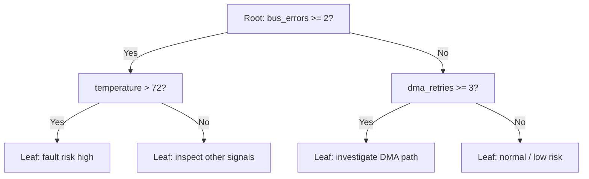
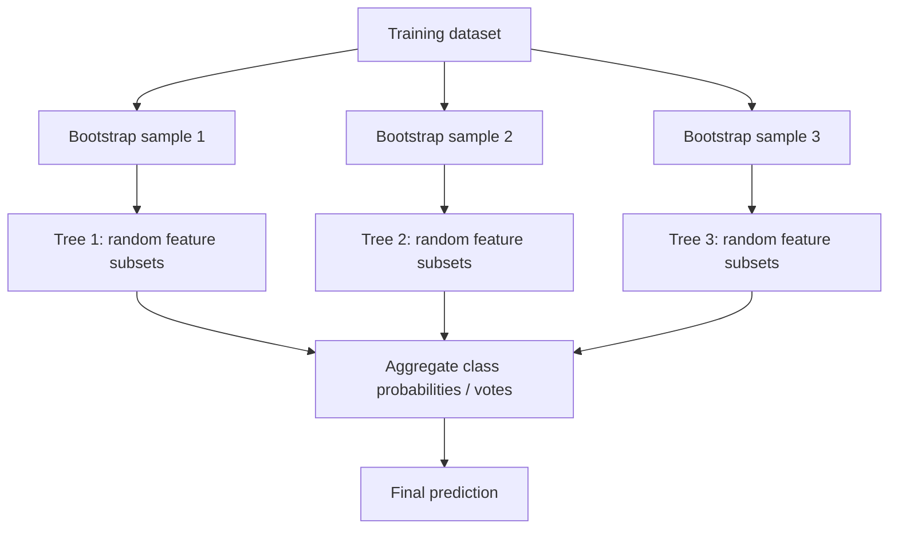
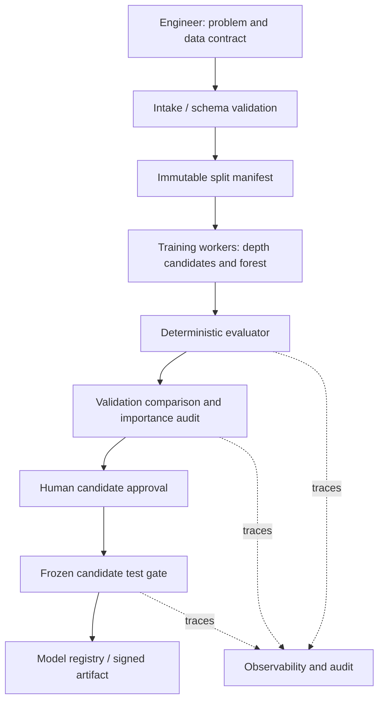

# Session 010 — Decision Trees, Entropy, Information Gain, CART and Random Forests

**Phase:** 3 — Machine Learning  
**Duration:** 60 minutes  
**Prerequisites:** Sessions 005–009 (probability, entropy, ML splits, logistic regression and evaluation)

## Learning objectives

By the end, you should be able to:

1. Explain how a decision tree recursively partitions feature space.
2. Calculate Gini impurity, entropy and weighted impurity reduction by hand.
3. Describe how CART searches binary splits and why the search is greedy.
4. Explain overfitting, depth/leaf constraints and cost-complexity pruning.
5. Explain bootstrap aggregation and feature subsampling in a random forest.
6. Distinguish impurity-based feature importance from permutation importance.
7. Build and evaluate trees and a random forest using a leakage-safe workflow.
8. Design an agent-assisted experiment workflow in which deterministic code owns training, metrics and promotion gates.

## 60-minute agenda

| Time | Activity |
|---|---|
| 0–5 min | Connect entropy and supervised learning to trees |
| 5–15 min | Tree anatomy and recursive partitioning |
| 15–25 min | Gini, entropy and information gain worked example |
| 25–35 min | CART, overfitting and pruning |
| 35–43 min | Random forests and feature importance |
| 43–55 min | Python lab |
| 55–60 min | Production architecture and review |

---

## 1. Why decision trees?

Linear and logistic regression learn a weighted sum of features. A decision tree learns a sequence of conditional tests:

- Is temperature greater than 72 °C?
- Are bus errors at least 2?
- Is DMA retry count greater than or equal to 3?

Each test routes a sample to a child node. A terminal **leaf** produces a class prediction or a numerical prediction.

Trees can represent nonlinear interactions without manually writing interaction terms. They usually need little feature scaling, but deep trees can memorize training data and are sensitive to changes in the sample.

A tree is a piecewise-constant model: every point in one leaf receives the same prediction.

## 2. Tree anatomy



- **Root:** first split; contains all training examples.
- **Internal node:** a feature test.
- **Branch:** outcome of a test.
- **Leaf:** terminal prediction.
- **Depth:** number of edges from root to a node.
- **Impurity:** how mixed the target labels are at a node.

The diagram is illustrative, not a fitted model.

## 3. Gini impurity and entropy

For a node with class proportions (p_1,ldots,p_K):

### Gini impurity

[
G=1-sum_{k=1}^{K}p_k^2
]

For binary classification, a pure node has Gini 0. A 50/50 node has Gini 0.5.

### Entropy

[
H=-sum_{k=1}^{K}p_klog_2(p_k)
]

A pure node has entropy 0. A balanced binary node has entropy 1 bit.

Both criteria quantify class mixing. They often choose similar splits, but they are not numerically identical. scikit-learn's CART implementation supports Gini and entropy/log-loss criteria.

### Worked split

A parent node contains 10 examples: 6 normal and 4 fault.

[
G_{parent}=1-(0.6^2+0.4^2)=0.48
]

Consider a candidate split:

- Left child: 5 normal, 0 fault; (G_L=0)
- Right child: 1 normal, 4 fault; (G_R=1-(0.2^2+0.8^2)=0.32)

Weighted child impurity:

[
G_{children}=rac{5}{10}(0)+rac{5}{10}(0.32)=0.16
]

Impurity reduction:

[
Delta G=0.48-0.16=0.32
]

The split reduces impurity by 0.32. CART searches candidate features and thresholds and greedily chooses a split with the best local improvement, subject to configured constraints.

For entropy, the parent has (Happrox0.971) bits. The right child has (Happrox0.722) bits and the left child has zero. Weighted child entropy is about 0.361 bits, so information gain is about 0.610 bits.

**Important:** a greedy locally best split is not a guarantee of the globally optimal tree.

## 4. How CART finds a split

For a numeric feature, candidate thresholds are considered between ordered feature values. Each candidate partitions the node's samples into left and right children. The criterion is calculated for both children, weighted by their sample counts.

Conceptually:

1. Start with all training rows at the root.
2. For each candidate feature and threshold, divide rows into left/right groups.
3. Calculate weighted child impurity.
4. Select the split with the greatest impurity reduction.
5. Repeat recursively for each child.
6. Stop when a stopping rule is reached.

Common stopping controls:

- `max_depth`: maximum tree depth.
- `min_samples_split`: minimum rows needed to split a node.
- `min_samples_leaf`: minimum rows allowed in a leaf.
- `max_leaf_nodes`: cap on leaf count.
- `min_impurity_decrease`: require a minimum split improvement.
- `ccp_alpha`: cost-complexity pruning strength.

scikit-learn's `DecisionTreeClassifier` uses an optimized CART implementation. In this implementation, categorical variables generally need encoding; do not assume arbitrary string categories are accepted directly.

## 5. Overfitting and pruning

A deep tree can keep splitting until it isolates individual training samples. Training accuracy may reach 100%, while unseen-data performance gets worse.

Use a validation set to compare tree complexity. Tune depth, leaf size and pruning strength on validation data only. After selecting and freezing the candidate, evaluate the test set once.

Cost-complexity pruning balances training impurity against tree size:

[
R_alpha(T)=R(T)+alpha,|widetilde T|
]

Here (R(T)) is the tree's total leaf risk, (|widetilde T|) is its number of leaves, and (alpha) penalizes complexity. Larger (alpha) favours smaller trees.

A tree is interpretable only relative to its size and feature quality. A tree with hundreds of leaves is not automatically an understandable explanation.

## 6. Random forests

A single tree has high variance: a small change in training samples can produce a different structure. A random forest reduces variance by averaging many diverse trees.



Two sources of randomness:

1. **Bootstrap sampling:** each tree is trained on a sample drawn with replacement from the training set.
2. **Feature subsampling:** each split considers only a subset of available features.

For classification, predicted class probabilities are commonly averaged across trees and converted into a class using a decision rule.

### Trade-offs

| Model | Strength | Limitation |
|---|---|---|
| Shallow tree | Fast, compact, easier to inspect | May underfit |
| Deep tree | Captures complex rules | High variance and overfitting |
| Random forest | Usually more stable and strong on tabular data | Larger memory/model and less transparent |
| Boosted trees | Can deliver strong accuracy through sequential error correction | More tuning-sensitive; not today's implementation |

Random forests do not make data leakage or distribution shift disappear. Their probabilities may also need calibration for high-stakes threshold decisions.

## 7. Feature importance: do not confuse split usage with causal impact

Two common approaches:

- **Mean decrease in impurity (MDI):** aggregates impurity reduction credited to a feature across tree splits. It is fast, but can favour high-cardinality features and can distribute importance unpredictably among correlated features.
- **Permutation importance:** shuffle one feature in an evaluation dataset and measure how much the chosen metric deteriorates. It measures reliance of this fitted model on that feature for that dataset and metric; it is not causal proof.

Use a held-out validation set for exploration. If features are correlated, shuffling one at a time may understate their joint value. Consider grouped permutation, domain checks and ablation experiments.

## 8. Worked engineering example

A telemetry classifier predicts whether an observation should be investigated for a possible fault.

Features:
- temperature
- DMA retries
- bus errors
- queue depth
- link flaps

A synthetic teaching rule creates nonlinear interactions such as high bus errors combined with high temperature. A tree can learn conditional interactions without a manually specified product feature.

This dataset is synthetic. It is designed to demonstrate algorithm behaviour, not to claim real silicon fault-detection performance.

## 9. Hands-on Python lab

### Setup

```bash
cd daily-lessons/day-010
python -m pip install -r requirements.txt
python lab.py
```

The lab:

1. Generates reproducible synthetic SoC telemetry.
2. Uses stratified train/validation/test splits.
3. Fits a majority-class baseline.
4. Trains shallow, moderate and unrestricted decision trees.
5. Trains a random forest with bootstrap samples and feature subsampling.
6. Reports accuracy, balanced accuracy, precision, recall, F1 and ROC-AUC.
7. Compares impurity-based and validation-set permutation importance.
8. Checks that an unrestricted tree can fit training data perfectly while generalizing worse.

### Reference run

With the committed seed and scikit-learn implementation, representative results are:

| Model | Test accuracy | Balanced accuracy | Precision | Recall | F1 | ROC-AUC |
|---|---:|---:|---:|---:|---:|---:|
| Majority baseline | 0.838 | 0.500 | 0.000 | 0.000 | 0.000 | 0.500 |
| Decision tree, depth 6 | 0.923 | 0.796 | 0.881 | 0.608 | 0.720 | 0.851 |
| Unrestricted tree | 0.873 | 0.783 | 0.600 | 0.649 | 0.624 | 0.783 |
| Random forest | 0.927 | 0.806 | 0.884 | 0.629 | 0.735 | 0.811 |

The unrestricted tree reaches 1.000 training accuracy but lower test accuracy, demonstrating overfitting. The random forest is not best on every metric: the depth-6 tree has higher ROC-AUC in this run. Select models against the deployment objective, not one headline score.

The lab also demonstrates a noisy feature receiving noticeable MDI importance but near-zero permutation importance. That is a useful warning against reading feature importance as causal truth.

## 10. Production-minded agent architecture — A16

### Tree Ensemble Experiment Gate

The model can help an engineer inspect results, but deterministic services own data access, training, metrics and promotion.



### Component boundaries

- **Intake/router:** validates task type, target, feature schema, data ownership and evaluation plan.
- **Split service:** creates and persists immutable row/group/time split manifests.
- **Training workers:** execute bounded, versioned tree/forest configurations. Workers cannot read the final test labels during tuning.
- **Evaluator:** calculates metrics with deterministic code and a versioned metric contract.
- **Importance auditor:** computes permutation importance on validation data and flags suspicious or unstable rankings.
- **Human approval:** reviews model card, trade-offs, dataset lineage and deployment impact.
- **Test gate and registry:** evaluates the frozen candidate on the test set and registers only an approved artifact.

### Typed tool examples

```json
{
  "tool": "train_tree_candidate",
  "input": {
    "dataset_version": "telemetry-v3",
    "split_manifest_id": "split-2026-11-28-a",
    "model_type": "decision_tree",
    "max_depth": 6,
    "min_samples_leaf": 3,
    "random_seed": 7
  },
  "output": {
    "run_id": "run-1042",
    "artifact_uri": "registry-staging/model-1042",
    "metrics_ref": "metrics-1042"
  }
}
```

The tool schema must reject unknown dataset versions, invalid parameters and unauthorized split IDs. The model must not be able to override policy by writing a prompt.

### State, memory and events

Persist experiment ID, data/split versions, model configuration, run status, artifact checksums, metrics references, approval identity and timestamps. Keep transient reasoning out of the authoritative experiment record.

Use event-driven workers for long-running training, with idempotency keys, bounded retries, checkpointing and dead-letter handling. Parallelize independent candidates only after reserving compute budgets and enforcing a concurrency limit.

### Security and evaluation

- Enforce dataset and test-label permissions in the service layer.
- Treat CSV text, metadata and retrieved documentation as untrusted content.
- Run training in a sandbox with resource limits.
- Redact secrets and sensitive rows from traces.
- Evaluate reproducibility, metric correctness, leakage, fairness where relevant, robustness and drift.
- Monitor model size, training time, inference latency and cost per successful investigation.
- Require human approval before model deployment or hardware-control integration.

### Architecture selection lesson

Use a deterministic pipeline for the fixed train/evaluate/register sequence. A single assistant with tools is enough for one engineer's experiment. Add supervisor/worker orchestration only when candidate runs are independent and parallelism provides measurable benefit. Use human approval for deployment. Do not create a multi-agent swarm just to train a tree.

## 11. Key terminology

| Term | Meaning |
|---|---|
| Impurity | Class mixing within a node |
| Gini impurity | (1-sum p_k^2) |
| Entropy | (-sum p_klog_2 p_k) |
| Information gain | Parent entropy minus weighted child entropy |
| CART | Classification and Regression Trees; binary recursive splitting |
| Greedy split | Best local split selected at the current node |
| Pruning | Removing complexity to improve generalization |
| Bootstrap | Sampling with replacement |
| Bagging | Training models on bootstrap samples and aggregating |
| Random forest | Bagged trees with feature subsampling |
| MDI | Mean decrease in impurity feature importance |
| Permutation importance | Metric degradation after feature shuffling |
| OOB | Out-of-bag samples not selected for a tree's bootstrap sample |

## 12. Five review questions

1. For a binary node with 6 normal and 4 fault examples, calculate its Gini impurity.
2. Why does CART choose the split with the largest local impurity reduction but not guarantee a globally optimal tree?
3. Why can an unrestricted decision tree achieve perfect training accuracy and still perform worse on test data?
4. How do bootstrap sampling and random feature subsets make a random forest different from a single tree?
5. Why is permutation importance not a causal explanation, and why should the final test set not be used to choose features?

## 13. Further reading

- scikit-learn, [Decision Trees user guide](https://scikit-learn.org/stable/modules/tree.html)
- scikit-learn, [DecisionTreeClassifier API](https://scikit-learn.org/stable/modules/generated/sklearn.tree.DecisionTreeClassifier.html)
- scikit-learn, [Ensemble methods and random forests](https://scikit-learn.org/stable/modules/ensemble.html)
- scikit-learn, [Permutation feature importance](https://scikit-learn.org/stable/modules/permutation_importance.html)
- Leo Breiman, [Random Forests (2001)](https://doi.org/10.1023/A:1010933404324)

## Next session — 011

**K-Nearest Neighbors, Naive Bayes and Support Vector Machines**

We will compare distance-based, probabilistic and margin-based learning, including scaling, kernels, decision boundaries and practical model selection.
