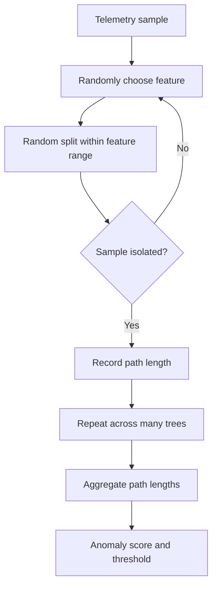
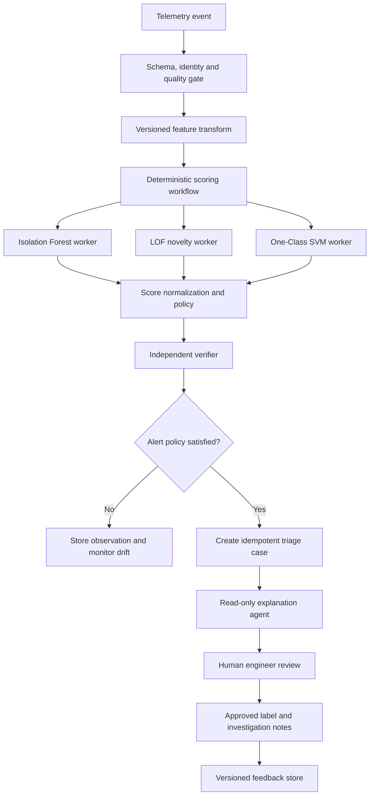

# Session 014 — Anomaly Detection: Isolation Forest, Local Outlier Factor and One-Class SVM

**Phase:** 3 — Machine Learning  
**Duration:** 60 minutes  
**Prerequisites:** Sessions 005, 008, 010–013: probability, data splitting, trees, nearest neighbors, clustering, PCA and evaluation.

## Why this lesson follows PCA

Session 013 showed how PCA can compress correlated telemetry and produce reconstruction residuals. This session moves from representation learning to direct anomaly detection. We will compare three complementary approaches:

- **Isolation Forest:** isolates unusual observations with random partitioning.
- **Local Outlier Factor (LOF):** compares a sample's local density with the density of its neighbors.
- **One-Class SVM:** learns a boundary around a reference population.

The engineering goal is not to label every unusual point as a silicon fault. It is to rank and triage observations, preserve evidence, and let validated policy plus human review determine what action is appropriate.

## Learning objectives

By the end of this session, you will be able to:

1. Distinguish outlier detection from novelty detection.
2. Explain how Isolation Forest uses path length rather than a distance metric.
3. Explain LOF using reachability distance and local reachability density.
4. Explain the One-Class SVM boundary, RBF kernel and `nu` parameter.
5. Compare score direction, thresholding, contamination and operating-point selection.
6. Evaluate rare-event detectors with precision, recall, PR-AUC, ROC-AUC and false-positive rate.
7. Build a leakage-safe novelty-detection experiment on telemetry.
8. Design an observable, secure, human-reviewed anomaly-triage agent workflow.

## One-hour plan

| Time | Activity |
|---|---|
| 0–5 min | Why anomaly detection follows PCA; terminology |
| 5–15 min | Outlier detection vs novelty detection; Isolation Forest |
| 15–27 min | LOF and local density |
| 27–37 min | One-Class SVM and RBF boundary |
| 37–43 min | Thresholds, metrics and base-rate effects |
| 43–55 min | Python lab and result interpretation |
| 55–60 min | Production agent architecture and review |

## 1. The problem: learn normal, surface unusual

A supervised classifier needs examples labelled with classes such as `normal` and `fault`. In real hardware work, faults can be rare, labels may arrive late, and a new failure mode may not have appeared in training.

Anomaly detection instead asks whether an observation is sufficiently inconsistent with a reference population.

Examples in SoC telemetry:

- DMA retries suddenly rise while temperature and queue pressure remain low.
- Bus errors increase only in one operating mode.
- A codec stream's latency distribution changes after a clock or firmware update.
- A PCIe link shows a combination of replay activity and throughput that was absent from the baseline.

An anomaly is a statistical observation, not a root-cause diagnosis. It can be a sensor error, a new but valid operating mode, a workload change, an instrumentation change or a real fault.

### Outlier detection versus novelty detection

| Mode | Training data | Question | Typical use |
|---|---|---|---|
| Outlier detection | May contain contaminated observations | Which points in this dataset look unlike the main population? | Data cleaning or retrospective exploration |
| Novelty detection | A reasonably clean reference set | Does this new observation differ from the learned normal population? | Monitoring incoming telemetry |

This lab uses **novelty detection**: each detector is fitted only on nominal training observations, then evaluated on a separate held-out set containing nominal and injected anomalies. The injected labels are used only to score the experiment; they are never passed to `.fit()` or used to tune thresholds.

## 2. Isolation Forest

### Intuition

Anomalies are often few and different. Randomly partitioning a dataset tends to isolate unusual points in fewer splits than ordinary points.

Isolation Forest builds many random isolation trees. Each split:

1. Selects a feature at random.
2. Selects a split value between that feature's observed minimum and maximum.
3. Recursively partitions the sample subset.

The number of splits needed to isolate a sample is its path length. Short average path lengths indicate greater abnormality.



### Why it can be efficient

- It does not need pairwise distances between all observations.
- Random subsampling limits the size of each tree.
- It can work well when anomalies are sparse and differ across feature dimensions.

### Important parameters

| Parameter | Meaning | Engineering trade-off |
|---|---|---|
| `n_estimators` | Number of isolation trees | More trees usually stabilize scores but increase compute |
| `max_samples` | Samples drawn for each tree | Smaller subsamples can be faster; too small may miss structure |
| `max_features` | Features sampled per tree | Can reduce feature coupling but may hide multivariate signals |
| `contamination` | Used to set the training-score threshold | It is a threshold assumption, not proof of the real fault prevalence |
| `random_state` | Reproducibility seed | Fix it for experiments and regression tests |

In scikit-learn, a negative `decision_function` value means an outlier; a positive value means an inlier. Lower raw `score_samples` values are more abnormal. Do not compare raw Isolation Forest scores numerically with LOF or SVM scores.

## 3. Local Outlier Factor (LOF)

Isolation Forest asks how quickly a point can be isolated. LOF asks a different question:

**Is this point much less locally dense than its neighbors?**

This is useful when a dataset contains legitimate operating modes with different densities. A globally sparse region may be normal for one mode but unusual relative to that mode's local neighborhood.

### The key quantities

- **k-distance:** distance from a point to its k-th nearest neighbor.
- **Reachability distance:** a distance adjusted by the neighbor's k-distance, reducing instability from very close points.
- **Local reachability density (LRD):** inverse of average reachability distance.
- **LOF:** average ratio of neighbors' local reachability densities to the point's own density.

Conceptually:

\[
LOF_k(p)=\frac{1}{|N_k(p)|}\sum_{o\in N_k(p)}\frac{LRD_k(o)}{LRD_k(p)}
\]

Interpretation:

- LOF near 1: density resembles its neighbors.
- LOF substantially above 1: the point is less dense than its neighbors and may be anomalous.

### The scikit-learn mode distinction matters

`LocalOutlierFactor` defaults to `novelty=False`, which is intended for outlier detection on the fitted dataset. To score future unseen observations, instantiate it with `novelty=True`, fit on the reference set, and use `predict`, `decision_function` or `score_samples` **only on new observations**. Do not use the novelty-mode prediction methods to rescore the training points: the neighborhood semantics differ.

### Trade-offs

- Captures local density differences that global methods can miss.
- Depends on feature scaling and distance choice.
- `n_neighbors` changes what “local” means.
- Neighbor search and memory can become expensive on large or high-dimensional datasets.
- A single neighborhood size may not suit modes with very different densities.

## 4. One-Class Support Vector Machine

A One-Class SVM estimates a region in feature space that contains most of the reference population. Points outside the learned region are treated as novel.

For an RBF kernel:

\[
K(x,z)=\exp(-\gamma\|x-z\|^2)
\]

The kernel allows a nonlinear boundary without explicitly constructing all transformed features.

### Parameters

| Parameter | Meaning | If increased |
|---|---|---|
| `nu` | Upper bound on training errors and lower bound on fraction of support vectors | Allows a larger training-error fraction and generally changes boundary complexity |
| `gamma` | RBF influence scale | Each support vector has more local influence; a boundary can become more intricate |
| `kernel` | Similarity function | Changes the geometry of the learned boundary |

`nu` is **not** a calibrated estimate of the future anomaly prevalence. It is a model constraint. Standardization is important because the RBF kernel depends on distances. One-Class SVM can be effective on carefully scaled data, but kernel training can become expensive as sample count grows. For large workloads, investigate linear or stochastic approximations and benchmark memory/latency.

In scikit-learn, `decision_function < 0` indicates an outlier for this detector too.

## 5. Compare the three approaches

| Property | Isolation Forest | LOF | One-Class SVM |
|---|---|---|---|
| Main signal | Short isolation path | Local density deficit | Outside learned support boundary |
| Needs feature scaling? | Usually less sensitive to affine scale changes | Yes, for distance-based features | Yes, especially with RBF |
| Learns nonlinear structure? | Through random partitions | Through neighborhoods | Through kernel boundary |
| Different local densities | Not explicitly modelled | A strength when k is suitable | Can struggle with multimodal structure |
| Large datasets | Often a strong starting point | Neighbor search may be costly | Kernel training may be costly |
| Explainability | Tree/path based, but not a causal explanation | Neighbor comparisons | Boundary/score, often harder to explain |
| Future-sample scoring | Yes | Set `novelty=True` | Yes |

There is no universally best detector. Use domain constraints, held-out labelled incidents, alert volume, runtime and stability to select a model.

## 6. Thresholds and evaluation

A detector produces a score. A separate policy converts the score into an alert. Keep these concepts separate.

For the three scikit-learn estimators used in the lab:

- `decision_function >= 0`: inlier under the fitted threshold.
- `decision_function < 0`: outlier under the fitted threshold.
- `anomaly_score = -decision_function`: larger values mean more anomalous.

`contamination` in Isolation Forest and LOF influences the threshold selected from training scores. One-Class SVM uses `nu` as an optimization constraint. None of these settings guarantees a correct production operating point.

### Metrics

\[
Precision=\frac{TP}{TP+FP},\qquad Recall=\frac{TP}{TP+FN}
\]

\[
FPR=\frac{FP}{FP+TN}
\]

Also track:

- **PR-AUC / average precision:** useful when anomalies are rare.
- **ROC-AUC:** ranking quality across thresholds; can look optimistic with rare positives.
- **Precision@K:** how many of the top K alerts are useful to investigators.
- **Alerts per device-day:** operational burden.
- **Detection delay:** time between the start of a condition and the alert.
- **Recall at a fixed false-positive budget:** often closer to the operational requirement.

### Base-rate example: why precision can collapse

Suppose a detector has 95% recall and a 5% false-positive rate. If only 1% of windows are truly anomalous:

\[
Precision=\frac{0.95\times0.01}{0.95\times0.01+0.05\times0.99}\approx16.1\%
\]

Even a detector with strong recall can generate many false alarms when the real anomaly prevalence is low. Evaluate at a realistic deployment base rate and measure analyst workload.

## 7. Worked hardware example

Assume a device reports this feature vector:

| Feature | Current value |
|---|---:|
| Temperature | 51 °C |
| DMA retries | 3.4 per window |
| Bus error rate | 0.29 |
| Queue pressure | 21% |

Temperature and queue pressure look like a low-load state, but retry and bus-error rates are unusually high for that state. This is a **contextual anomaly**: individual values may not all be extreme, while their combination is unusual.

A good triage record should preserve:

- raw feature values and units;
- device, firmware, workload and operating-mode context;
- feature schema and preprocessing versions;
- detector version and score;
- threshold policy and reason for alert;
- nearby reference observations or a safe explanation;
- timestamps, data-quality flags and trace/correlation IDs.

The detector does not prove whether the cause is DMA, interconnect, firmware, clocking or a sensor problem. That requires further evidence.

## 8. Hands-on lab: synthetic SoC telemetry novelty detection

The runnable lab is in [`lab.py`](./lab.py). It creates a deterministic synthetic dataset with three legitimate operating modes and three kinds of injected anomalies: gross spikes, contextually inconsistent telemetry and subtler combinations.

### Dataset contract

Features:

1. `temperature_c`
2. `dma_retries`
3. `bus_error_rate`
4. `queue_pressure`

The experiment uses:

- 1,800 nominal training samples;
- 600 nominal held-out samples;
- 80 injected held-out anomalies;
- fixed random seed `14014`.

Only nominal training samples are used to fit the detectors and the scaler. Held-out labels are used only for metrics.

### Models

| Model | Configuration |
|---|---|
| Isolation Forest | 300 trees, `contamination=0.05` |
| LOF novelty mode | 25 neighbors, `novelty=True`, `contamination=0.05` |
| One-Class SVM | RBF kernel, `nu=0.05`, `gamma='scale'` |

All are wrapped in a `StandardScaler` pipeline so the distance-based LOF and RBF SVM receive comparable scaled features. Scaling is less critical to Isolation Forest itself.

### Reproduced held-out results

With scikit-learn 1.8.0, NumPy 2.3.5 and the fixed seed, the lab produced:

| Detector | Precision | Recall | F1 | Balanced accuracy | ROC-AUC | Average precision | FPR |
|---|---:|---:|---:|---:|---:|---:|---:|
| Isolation Forest | 0.714 | 1.000 | 0.833 | 0.973 | 0.995 | 0.959 | 0.053 |
| LOF novelty | 0.741 | 1.000 | 0.851 | 0.977 | 1.000 | 1.000 | 0.047 |
| One-Class SVM | 0.748 | 1.000 | 0.856 | 0.978 | 1.000 | 1.000 | 0.045 |

These deliberately controlled synthetic anomalies are detectable by all three methods. This is not evidence that all detectors will achieve perfect recall on real hardware failures. The precision values are also constrained by the synthetic test prevalence (80/680); production precision can be much lower when incidents are rarer.

### Run it

```bash
cd daily-lessons/day-014
python -m pip install -r requirements.txt
python lab.py
```

### Exercises

1. Change `n_neighbors` from 25 to 10 and 50. Record LOF precision, recall and FPR.
2. Change One-Class SVM `nu` to 0.02 and 0.10. Explain why this is not the same as changing the real fault rate.
3. Change Isolation Forest `contamination` to `0.02` and `0.10`. Observe how the threshold and alert volume change.
4. Remove the `StandardScaler` from LOF and One-Class SVM. Explain why units can dominate distance and kernel geometry.
5. Add a new operating mode to the nominal generator. Which detector becomes least stable, and what does that say about the baseline?
6. Replace random held-out sampling with a time-ordered split. Explain why this is closer to deployment monitoring.

## 9. Production agent architecture: Anomaly Detection and Human Triage Gate (A20)

The LLM helps interpret requests, select a documented experiment and summarize evidence. Deterministic services own data validation, feature transforms, detector execution, thresholds, access control and case transitions.



### Component boundaries

| Component | Responsibility | Must not do |
|---|---|---|
| Intake/router agent | Convert a request into a typed experiment request; choose a documented detector family | Grant data access or invent detector scores |
| Data contract service | Validate feature names, units, schema, freshness and device scope | Silently fill missing safety-critical values |
| Feature service | Apply the exact versioned transform | Fit a new scaler during online inference |
| Detector workers | Return score, model version and timing | Decide a root cause or take remediation action |
| Policy gate | Apply deterministic thresholds, severity and rate limits | Trust free-form model confidence |
| Verifier | Check schema, finite scores, version compatibility and policy invariants | Reuse the same model response as independent proof |
| Explanation agent | Summarize measured evidence and retrieve approved runbooks | Execute shell, firmware, register or reset actions |
| Human reviewer | Confirm, reject, classify or escalate a case | Lose the provenance of the decision |

### Which agent pattern fits?

- **Deterministic workflow:** use it for validation → transform → score → policy → case creation. This is the default production path.
- **Single agent with typed tools:** a single read-only assistant can request `score_window`, `get_model_metadata` and `fetch_approved_runbook` tools.
- **Router-specialist:** route to Isolation Forest, LOF or One-Class SVM experiment specialists only when their assumptions and cost profiles differ. The router chooses a workflow, not permissions.
- **Planner–executor–verifier:** useful for offline experiments: plan a bounded parameter sweep, execute candidates, then independently validate metrics and artifact lineage.
- **Supervisor–worker:** run independent detector or feature-ablation experiments in parallel. Require a shared dataset fingerprint and explicit aggregation rules.
- **Event-driven:** ingest telemetry asynchronously using an event ID, checkpoint and idempotent case key. Send poison events to a dead-letter queue rather than retrying forever.
- **Human-in-the-loop:** require engineering review before assigning a fault cause, changing a threshold for production, suppressing an alert class or taking a corrective action.

### Typed tool contract example

```json
{
  "name": "score_telemetry_window",
  "input": {
    "device_scope": "approved-device-group",
    "window_id": "opaque-window-id",
    "feature_schema_version": "telemetry-v3",
    "detector_bundle_version": "anomaly-bundle-2026-11",
    "request_id": "uuid"
  },
  "output": {
    "case_id": "opaque-case-id",
    "scores": {
      "isolation_forest": 0.42,
      "lof": 0.18,
      "one_class_svm": -0.07
    },
    "score_semantics": "detector-specific; not calibrated probabilities",
    "decision": "review_required",
    "model_versions": {},
    "trace_id": "trace-id"
  }
}
```

The values above are illustrative only. In a real schema, validate enums, ranges, required fields, units and authorization scope. Never treat raw scores from different algorithms as directly comparable; calibrate or rank them using a documented validation process.

### State and memory

Persist operational state, not an unbounded transcript:

- event ID, device scope and telemetry window;
- feature schema, units, transform/scaler and model bundle versions;
- detector scores, threshold policy and data-quality status;
- case state (`new`, `reviewing`, `confirmed`, `dismissed`, `escalated`);
- reviewer identity, timestamp, reason and evidence references;
- retry count, checkpoint and trace ID.

Approved investigation notes can become versioned episodic knowledge with provenance, access control and expiry. Do not silently convert an unreviewed model alert into ground-truth memory.

### Security and safety

- Treat logs, firmware strings, device names and uploaded traces as untrusted data; prompt injection inside them must not alter tool policy.
- Enforce tenant/device authorization in the tool service, not in the prompt.
- Give scoring tools read-only access to telemetry and model artifacts.
- Keep secrets out of prompts, traces and notebook outputs.
- Do not expose unrestricted shell, SSH, register-write or firmware-flash tools to the explanation agent.
- Validate payload size, feature ranges, timestamps and schema versions.
- Require a human approval record for high-impact actions.

### Evaluation and observability

Track both model quality and workflow quality:

| Area | Measurements |
|---|---|
| Detection | Precision, recall, PR-AUC, ROC-AUC, recall at fixed FPR |
| Operations | Alerts/device-day, analyst acceptance, time-to-triage, duplicate-case rate |
| Drift | Feature distribution drift, score distribution drift, new operating modes |
| Reliability | Missing-feature rate, stale-model rate, retry count, dead-letter count |
| Performance | p50/p95/p99 scoring latency, throughput, CPU and memory |
| Cost | Cost per million windows, storage per case, explanation tokens per reviewed case |
| Agent quality | Correct tool selection, schema-valid calls, unsupported-claim rate, escalation precision |

Every trace should carry `request_id`, `event_id`, `device_scope`, `feature_schema_version`, `model_bundle_version`, detector name, threshold policy version, duration and outcome. Avoid logging raw sensitive telemetry unless explicitly approved.

### Reliability and cost/latency

- Use bounded retries only for transient storage or queue failures; do not retry invalid feature schemas.
- Use an idempotency key such as `(device_id, window_start, feature_schema_version, model_bundle_version)` to prevent duplicate cases.
- Checkpoint long-running offline experiments and store candidate artifacts by immutable content hash.
- Run a cheap first-stage detector only if it reduces total expected cost without unacceptable missed-anomaly risk.
- Parallel workers reduce wall-clock time but increase concurrent CPU/memory and orchestration cost.
- Use a rule-based or last-known-good fallback only with explicit freshness checks; missing or stale input must become `insufficient_data`, never silently `normal`.
- Keep model scoring deterministic and the LLM explanation optional, so an LLM outage does not stop telemetry monitoring.

## 10. Key terminology

| Term | Definition |
|---|---|
| Anomaly | Observation that differs from an expected pattern |
| Outlier detection | Finds unusual points in a potentially contaminated dataset |
| Novelty detection | Learns a clean reference population and scores future samples |
| Isolation path length | Number of random splits needed to isolate a sample |
| Reachability distance | LOF distance adjusted using a neighbor's k-distance |
| Local reachability density | Inverse average reachability distance in a neighborhood |
| LOF | Ratio comparing a point's local density with neighbors' densities |
| One-Class SVM | Learns a boundary around a reference distribution |
| `nu` | One-Class SVM constraint on training errors/support vectors |
| Contamination | Assumed outlier fraction used to set some estimator thresholds |
| Novelty threshold | Boundary that converts a continuous score into an alert |
| Base rate | Actual prevalence of anomalies in the monitored population |
| Drift | Change in input or score distributions over time |
| Idempotency | Repeating the same event does not create duplicate side effects |
| Abstention | Explicitly declining to classify when evidence is insufficient |

## 11. Five review questions

1. What is the difference between outlier detection and novelty detection, and which one does this lab implement?
2. Why can Isolation Forest identify an anomaly without computing nearest-neighbor distances?
3. Why must LOF use `novelty=True` when scoring future telemetry windows, and which methods should be used on unseen data?
4. Why is One-Class SVM's `nu` not a direct estimate of future fault prevalence?
5. If anomaly prevalence is 1%, why can a detector with 95% recall and 5% FPR still have low precision?

## 12. References

1. [scikit-learn User Guide — Novelty and Outlier Detection](https://scikit-learn.org/stable/modules/outlier_detection.html)
2. [scikit-learn — IsolationForest API](https://scikit-learn.org/stable/modules/generated/sklearn.ensemble.IsolationForest.html)
3. [scikit-learn — LocalOutlierFactor API](https://scikit-learn.org/stable/modules/generated/sklearn.neighbors.LocalOutlierFactor.html)
4. [scikit-learn — OneClassSVM API](https://scikit-learn.org/stable/modules/generated/sklearn.svm.OneClassSVM.html)
5. Liu, Ting and Zhou, “Isolation Forest,” IEEE ICDM 2008, [DOI: 10.1109/ICDM.2008.17](https://doi.org/10.1109/ICDM.2008.17)
6. Breunig et al., “LOF: Identifying Density-Based Local Outliers,” ACM SIGMOD 2000, [DOI: 10.1145/342009.335388](https://doi.org/10.1145/342009.335388)
7. Schölkopf et al., “Estimating the Support of a High-Dimensional Distribution,” Neural Computation 2001, [DOI: 10.1162/089976601750264965](https://doi.org/10.1162/089976601750264965)

## Session takeaway

Anomaly detection is a ranking and triage capability, not a root-cause oracle. Keep the reference population clean, choose the correct novelty/outlier mode, calibrate thresholds against realistic base rates, preserve model/data provenance, and put a deterministic policy plus human review between an unusual score and a hardware action.
